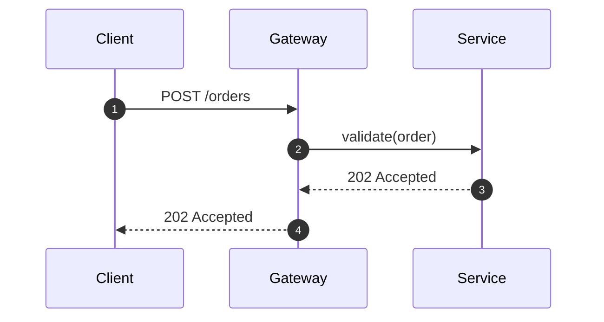
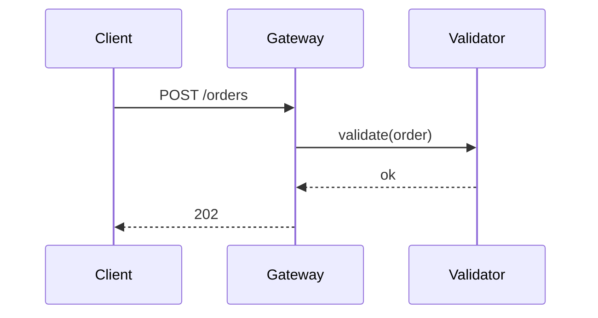

# presenterm reference

Read only the sections relevant to the task. Command and configuration examples may depend on the installed version.

## Contents

- Toolchain
- CLI
- Deck Skeleton
- Slide Boundaries
- Comment Commands
- Layouts — the main composition tool
- Images
- Diagrams
- Code
- Themes
- Slide Recipes
- Config File
- Export

## Toolchain

| Tool | Needed for | Install (macOS) |
|------|-----------|-----------------|
| `presenterm` | everything | `brew install presenterm` / `cargo install --locked presenterm` |
| `mmdc` (mermaid-cli) | `mermaid +render` diagrams, sequence diagrams | `npm install -g @mermaid-js/mermaid-cli` |
| `d2` | `d2 +render` diagrams | `brew install d2` |
| `typst` | `typst +render` formulas | `brew install typst` |
| `pandoc` | `latex +render` (converted to typst) | `brew install pandoc` |
| `weasyprint` | `--export-pdf` | `uv tool install weasyprint` (or `uv run --with weasyprint presenterm -e deck.md`) |

**Terminal matters.** Images and rendered diagrams need the kitty graphics protocol, the iTerm2 protocol, or
sixel. kitty, WezTerm, ghostty, foot, and iTerm2 qualify. Anywhere else images degrade to ASCII blocks.
Force a protocol with `--image-protocol` if detection misfires.

Verify before promising a feature works:

```bash
command -v presenterm mmdc d2 typst pandoc
presenterm --version
```

## CLI

```bash
presenterm deck.md                      # author mode: hot reload on save
presenterm -p deck.md                   # presentation mode: no reload
presenterm -t catppuccin-mocha deck.md  # override theme
presenterm --validate-overflows deck.md # fail loudly if a slide doesn't fit the screen
presenterm -x deck.md                   # allow +exec snippets (<c-e> to run)
presenterm -X deck.md                   # allow +exec_replace / +image snippets (auto-runs!)
presenterm --validate-snippets deck.md  # run every exec snippet at startup, report failures
presenterm -e deck.md -o out.pdf        # export PDF (needs weasyprint)
presenterm -E deck.md                   # export self-contained HTML
presenterm --list-themes                # preview every built-in theme
presenterm --list-comment-commands      # machine-readable command list
presenterm -P deck.md                   # publish speaker notes
presenterm -l deck.md                   # second window: listen for speaker notes
```

**Key bindings while presenting:** `l/j/→/space` next · `h/k/←` previous · `n`/`p` fast next/prev (skips
pauses) · `gg` first · `G` last · `12G` slide 12 · `<c-p>` slide index · `?` bindings · `T` toggle layout
grid · `<c-e>` execute snippet · `<c-c>`/`q` quit.

## Deck Skeleton

```markdown
---
title: "Streaming Ingest at **Scale**"
sub_title: How we cut p99 latency by 80%
author: Ivan Perdomo
event: Platform Guild
date: 2026-09-15
theme:
  name: catppuccin-mocha
options:
  implicit_slide_ends: true
  incremental_lists: false
---

Agenda
===

* Where we were
* What we changed
* What it cost

<!-- end_slide -->
```

Front matter is optional, but setting any of `title` / `sub_title` / `author` / `authors` / `event` /
`location` / `date` generates an **intro slide** — a styled cover that keeps the deck from opening on raw
markdown. `event`, `location`, and `date` render as a group below the author, and all seven are also
available as `{title}`, `{event}`, `{date}`… inside a template footer. Titles accept arbitrary markdown,
including `<span>` tags. `author` and `authors` are mutually exclusive.

## Slide Boundaries

| Mechanism | How | When to use |
|-----------|-----|-------------|
| `<!-- end_slide -->` | explicit comment | **Default. Prefer this.** Unambiguous while editing |
| `implicit_slide_ends: true` | a slide title implies the previous slide ended | Content-dense decks where every slide has a title |
| `end_slide_shorthand: true` | `---` thematic break also ends a slide | Porting a deck from another tool |

**Slide titles are setext headers** — a line of text underlined by `===` or `---`:

```markdown
Why this is slow
================
```

Always underline with `===`. `---` is also a valid setext underline but collides visually with front matter
and with `end_slide_shorthand`. Slide titles get their own theme style (centered, padded, recolored,
`font_size: 2` in the built-in themes) — this is what makes a deck look like a deck instead of a README.
`# ATX headings` are *headings*, styled differently, and only become titles if you set `h1_slide_titles: true`.

## Comment Commands

| Command | Effect |
|---------|--------|
| `<!-- end_slide -->` | end the current slide |
| `<!-- pause -->` | reveal the rest only on the next keypress |
| `<!-- incremental_lists: true \| false -->` | every bullet from here reveals one at a time |
| `<!-- list_item_newlines: 2 -->` | blank lines between list items — spreads a short list over the slide |
| `<!-- new_line -->` / `<!-- new_lines: N -->` | explicit vertical space (markdown collapses blank lines) |
| `<!-- jump_to_middle -->` | vertically center the rest of the slide |
| `<!-- alignment: left \| center \| right -->` | horizontal alignment for the rest of the slide |
| `<!-- column_layout: [2, 1] -->` | define columns for this slide |
| `<!-- column: 0 -->` | write into column N (0-indexed) |
| `<!-- reset_layout -->` | leave columns; subsequent content spans full width |
| `<!-- font_size: 2 -->` | 1–7, kitty ≥ 0.40 only; silently ignored elsewhere |
| `<!-- no_footer -->` | hide the footer on this slide |
| `<!-- skip_slide -->` | exclude this slide from the deck entirely |
| `<!-- include: part.md -->` | inline another markdown file (its relative paths resolve to *its* directory) |
| `<!-- speaker_note: ... -->` | note shown only in the `--listen-speaker-notes` window |
| `<!-- snippet_output: id -->` | render a `+id:` snippet's output here |
| `<!-- // note -->` / `<!-- comment: note -->` | a real comment, ignored at render time |

Multiline form (YAML inside the comment) — required for multiline speaker notes:

```markdown
<!--
speaker_note: |
  Pause here.
  Ask whether anyone has hit this in production.
-->
```

## Layouts — the main composition tool

Define a layout, then enter each column. Units are relative shares of the screen width.

```markdown
<!-- column_layout: [2, 1] -->   # 2/3 and 1/3

<!-- column: 0 -->
narrative goes here

<!-- column: 1 -->


<!-- reset_layout -->
this spans the full width again
```

The layout resets at the end of the slide, so `reset_layout` is only needed mid-slide.

**Idioms worth memorizing:**

| Layout | Purpose |
|--------|---------|
| `[1, 1]` | side-by-side comparison (before/after, ours/theirs) |
| `[2, 1]` or `[3, 2]` | narrative + supporting visual. The dominant technical-deck layout |
| `[1, 3, 1]` writing only into column 1 | **centering trick** — content occupies the middle 60%, gaining breathing room a full-width slide never has |
| `[1, 1, 1]` | three-beat comparison; do not go past 4 columns in a terminal |

Press `T` while presenting to overlay the column grid — use it to check that a diagram isn't crammed.

## Images

```markdown
                  # original pixel size, shrunk only if it overflows
   # 60% of terminal width, aspect ratio preserved
       # short form
```

- Paths are relative to **the presentation file**.
- Remote URLs are not supported by design. Download assets into the deck directory.
- Aspect ratio is always preserved and images never overflow.
- Under tmux you must enable `allow-passthrough` or images will not render.
- To drop the `image:` prefix entirely, set `options.image_attributes_prefix: ""` and write ``.

Almost always set an explicit width. Original-size images are the single most common reason a deck looks
unbalanced — a 1200px screenshot will eat the whole slide on one machine and look tiny on another.

## Diagrams

### Mermaid — flowcharts, sequence diagrams, state machines

````markdown

````

- Requires `mmdc`. Each diagram spins up a headless browser — budget ~2s per diagram at load time.
  Rendering is async across `snippet.render.threads` (default 2).
- Set `mermaid.scale` in the **config file** until diagrams look crisp at their natural size, *then* trim
  individual ones with `+width:N%`. Scaling a small render up with `+width` produces a blurry image.
- Theme the output via `mermaid.background` and `mermaid.theme` in your presentation theme.
- `options.auto_render_languages: [mermaid]` makes `+render` implicit — but then you **cannot** use
  `+width`, which is rejected unless `+render` is literally present. Pick one: implicit rendering, or
  per-diagram widths. For a deck with sized diagrams, write `+render` every time.

**Sequence diagram guidance:** keep participants to 3–5 and messages to ~8. Beyond that, split across slides
and reveal the interaction in stages — one slide per phase reads far better than one dense diagram.

### D2

````markdown
```d2 +render +width:60%
orders: {
  shape: sql_table
  id: int {constraint: primary_key}
  created_at: timestamp
}
```
````

Requires `d2`. Same `+width` / `d2.scale` tradeoff as mermaid. Theme with the `d2.theme` key.

### Formulas — LaTeX and typst

````markdown
```typst +render +width:40%
$ f(x) = sum_(n=1)^oo 2^(-n) $
```

```latex +render
\[ \sum_{n=1}^{\infty} 2^{-n} = 1 \]
```
````

`typst` renders natively; `latex` is converted to typst via `pandoc` first, so LaTeX needs both. Tune
sharpness with `typst.ppi` in the config file (default 300). Images referenced inside typst snippets must
use absolute paths (`#image("/logo.png")`) resolved relative to the presentation's directory.

### Choosing a diagram tool

- **mermaid** — sequence diagrams, flowcharts, state diagrams, anything you'd sketch on a whiteboard. Default choice.
- **d2** — dense architecture diagrams, ER/table shapes, nested containers. Better auto-layout for boxes-and-arrows at scale.
- **static image** — anything hand-designed, or when you cannot depend on `mmdc`/`d2` on the presenting machine.
- **ASCII in a code block** — perfectly legitimate for a 3-box pipeline, and it costs zero render time.

Rendered diagrams are baked in at load, so they export to PDF/HTML fine.

## Code

````markdown
```rust +line_numbers
fn main() { println!("hi"); }
```
````

**Selective highlighting** — dim everything but the lines that matter:

````markdown
```rust {1,3,5-7}
```
````

**Dynamic highlighting** — `|` separates frames; each keypress advances the highlight. This is the single
best feature for walking an audience through code:

````markdown
```rust {1-3|5-9|all}
```
````

**External snippets** keep real, compilable code out of the deck:

````markdown
```file +line_numbers
path: src/pipeline.rs
language: rust
start_line: 40
end_line: 62
```
````

**Hidden lines** — executed but not displayed. Prefix is per-language: `# ` for rust,
`/// ` for python/bash/fish/shell/zsh/kotlin/java/js/ts/c/c++/go.

````markdown
```python +exec
/// import json
print(json.dumps({"ok": True}))
```
````

**Execution attributes:**

| Attribute | Behavior |
|-----------|----------|
| `+exec` | run on `<c-e>`, output appears below. Requires `-x` |
| `+auto_exec` | like `+exec` but runs without a keypress |
| `+exec_replace` | runs at load, snippet is *replaced* by its output. Requires `-X` |
| `+image` | like `+exec_replace`, output must be raw jpg/png. Requires `-X` |
| `+pty` / `+pty:80:30` / `+pty:standby` | run in a pseudo terminal (for `top`-like tools) |
| `+acquire_terminal` | hand the raw terminal over (combine with `+exec`) |
| `+id:name` | tag output for later `<!-- snippet_output: name -->` |
| `+validate` / `+expect:failure` | checked by `--validate-snippets`, not executable |
| `+no_background` | drop the snippet background — pairs with `+exec_replace` |
| `+exec:rust-script`, `+exec:uv`, `+exec:pytest` | alternative executors |

> Live execution is the highest-risk part of a deck. It is also the highest-payoff moment when it works.
> Rehearse with `--validate-snippets`, and never enable `-X` on someone else's deck.

Code highlighting covers ~60 languages via `bat`'s syntax set; execution support is a smaller subset
(bash, python, rust, go, java, js/ts, ruby, elixir, C/C++/C#, lua, and more). Add unsupported languages via
`snippet.exec.custom` in the config file.

## Themes

### Selecting

```yaml
---
theme:
  name: catppuccin-mocha          # a built-in or a ~/.config/presenterm/themes/*.yaml
---
```

```yaml
---
theme:
  light: catppuccin-latte         # auto-switch on terminal background
  dark: catppuccin-mocha
---
```

```yaml
---
theme:
  path: ./theme.yaml              # a theme file shipped with the deck
---
```

**Built-ins:** `dark`, `light`, `terminal-dark`, `terminal-light`, `gruvbox-dark`,
`catppuccin-{latte,frappe,macchiato,mocha}`, `tokyonight-{day,storm,moon,night}`.
`terminal-*` inherit your terminal's colors — the right pick if your terminal has a background image or
transparency you want to keep.

### Overriding inline

Fastest way to get a distinctive look without maintaining a theme file. Overrides hot-reload, so you can
iterate on colors live:

```yaml
---
theme:
  name: catppuccin-mocha
  override:
    default:
      margin:
        percent: 8
    slide_title:
      prefix: "▌ "
      separator: true
      padding_bottom: 1
    footer:
      style: template
      left: "**{title}**"
      center: "_{event}_"
      right: "{current_slide} / {total_slides}"
      height: 2
---
```

### Theme file reference

Custom themes live in `~/.config/presenterm/themes/*.yaml` (macOS:
`~/Library/Application Support/presenterm/themes/`) and become usable by filename, or ship next to the deck
and reference with `theme.path`.

```yaml
extends: catppuccin-mocha   # inherit everything, override selectively

palette:
  colors:
    accent: "89b4fa"
    warn:   "f9e2af"
    dim:    "6c7086"
  classes:
    callout:
      foreground: "1e1e2e"
      background: "89b4fa"

default:
  margin: { percent: 8 }              # or { fixed: 5 }
  colors: { foreground: "cdd6f4", background: "1e1e2e" }

intro_slide:
  title:     { alignment: center, colors: { foreground: "p:accent" } }
  subtitle:  { alignment: center }
  event:     { alignment: center, colors: { foreground: "p:dim" } }
  location:  { alignment: center, colors: { foreground: "p:dim" } }
  date:      { alignment: center, colors: { foreground: "p:dim" } }
  author:    { alignment: center, positioning: below_title }   # or page_bottom
  footer: false                       # show the footer on the intro slide?

slide_title:
  prefix: "▌ "
  font_size: 2
  padding_top: 1
  padding_bottom: 1
  separator: true
  bold: true
  colors: { foreground: "p:accent" }

headings:
  h1: { prefix: "██", colors: { foreground: "p:accent" } }
  h2: { prefix: "▓▓", colors: { foreground: "p:warn" } }

footer:
  style: template                     # template | progress_bar | empty
  left: "My **name** is {author}"
  center: { image: logo.png }         # images allowed in any position
  right: "{current_slide} / {total_slides}"
  height: 2

code:
  theme_name: catppuccin-mocha        # syntect theme; drop .tmTheme files in themes/highlighting/
  background: true
  line_numbers: false
  padding: { horizontal: 2, vertical: 1 }

execution_output:                     # output box under a +exec snippet
  colors: { foreground: "cdd6f4" }
  padding: { horizontal: 2, vertical: 1 }
  status:
    running:     { foreground: "p:warn" }
    success:     { foreground: "p:ok" }
    failure:     { foreground: "f38ba8" }
    not_started: { foreground: "p:dim" }

pty_output:                           # output box for +pty snippets
  colors: { foreground: "cdd6f4" }
  cursor: { symbol: "█", highlight_colors: { background: "p:accent" } }

block_quote:
  prefix: "▍ "

table: { alignment: center }          # tables accept an alignment block
alignment: { alignment: left }        # default alignment for everything

inline_code: { colors: { foreground: "p:warn" } }
bold:        { colors: { foreground: "p:accent" } }
italics:     { colors: { foreground: "p:dim" } }

mermaid: { background: transparent, theme: dark }
d2:      { theme: 200 }              # d2 theme id (a number, not a name)

modals:                               # <c-p> index and ? bindings modals
  colors: { foreground: "cdd6f4", background: "313244" }
  selection_colors: { background: "p:accent", foreground: "1e1e2e" }

layout_grid: { color: "p:dim" }       # the grid toggled with `T`

typst:
  colors: { background: "1e1e2e", foreground: "cdd6f4" }
  horizontal_margin: 2
  vertical_margin: 2

alert:
  base_colors: { foreground: "cdd6f4" }
  prefix: "▍ "
  styles:
    note:      { color: blue,   title: Note,      icon: "" }
    tip:       { color: green,  title: Tip,       icon: "" }
    important: { color: cyan,   title: Important, icon: "" }
    warning:   { color: yellow, title: Warning,   icon: "" }
    caution:   { color: red,    title: Caution,   icon: "" }
```

Reference palette colors anywhere a color is expected as `p:name` or `palette:name`.

Theme files use `deny_unknown_fields`: a typo'd or invented key fails the whole deck rather than being
ignored. The complete set of root keys is `extends`, `default`, `alignment`, `palette`, `intro_slide`,
`slide_title`, `headings`, `footer`, `code`, `execution_output`, `pty_output`, `inline_code`, `bold`,
`italics`, `table`, `block_quote`, `alert`, `typst`, `mermaid`, `d2`, `modals`, `layout_grid`.

Alignment blocks accept `alignment: left|center|right` plus `margin: {fixed: N}` or `{percent: N}`;
`alignment: center` accepts `minimum_size` and `minimum_margin` instead. Percent margins survive terminal
resizes better than fixed ones.

### Colored text

Only `<span>` tags are supported, and only `color` / `background-color`:

```markdown
<span style="color: p:accent">p99 latency</span> dropped <span class="callout">80%</span>
```

Code themes are separate from the deck theme (`code.theme_name`, a syntect theme). Pick one whose background
matches `default.colors.background` or the snippet will look pasted on.

GitHub-style alerts render natively — use them instead of hand-rolled callouts:

```markdown
> [!WARNING]
> This path is not idempotent.
```

## Slide Recipes

**Title slide** — from front matter, nothing else needed:

```markdown
---
title: "Streaming Ingest at **Scale**"
sub_title: How we cut p99 latency by 80%
author: Ivan Perdomo
---
```

**Section divider:**

```markdown
<!-- jump_to_middle -->

Part II — What we changed
=========================

<!-- end_slide -->
```

**Narrative + diagram:**

````markdown
Request path today
==================

<!-- column_layout: [2, 3] -->

<!-- column: 0 -->

* Gateway fans out to 3 services
* Each hop adds a serialization round trip
* p99 dominated by the **validate** call

<!-- column: 1 -->



<!-- end_slide -->
````

**Before / after comparison:**

````markdown
The fix
=======

<!-- column_layout: [1, 1] -->

<!-- column: 0 -->

**Before** — 340ms p99

```python {2-4}
def handle(req):
    payload = serialize(req)
    resp = validator.call(payload)
    return deserialize(resp)
```

<!-- column: 1 -->

**After** — 62ms p99

```python {2-3}
def handle(req):
    with validator.batch() as b:
        return b.submit(req)
```

<!-- end_slide -->
````

**Progressive reveal — problem, then answer:**

````markdown
Why was it slow?
================

Every request paid for a full schema validation.

<!-- pause -->

<!-- new_line -->

> [!TIP]
> Schemas change once a day. Requests arrive 40k times a second.

<!-- end_slide -->
````

**Code walkthrough:**

```markdown
The batching loop
=================

```rust +line_numbers {1-4|6-9|11-13|all}
pub struct Batcher {
    queue: Vec<Request>,
    window: Duration,
}
...
```

<!-- end_slide -->
```

**Centered statement slide:**

```markdown
<!-- jump_to_middle -->
<!-- alignment: center -->

<!-- column_layout: [1, 3, 1] -->
<!-- column: 1 -->

# 80% lower p99, zero schema regressions

<!-- end_slide -->
```

**Spaced-out short list:**

```markdown
Three things to take away
=========================

<!-- list_item_newlines: 3 -->

* Validate once, not per request
* Batch at the edge, not the core
* Measure p99, never the mean

<!-- end_slide -->
```

**Live demo with a fallback:**

```markdown
It actually works
=================

```bash +exec
curl -s localhost:8080/health | jq .
```

<!-- speaker_note: if the service is down, skip to the recorded output on the next slide -->

<!-- end_slide -->
```

## Config File

Machine-level settings (not deck-level) live at `~/.config/presenterm/config.yaml`
(macOS: `~/Library/Application Support/presenterm/config.yaml`).

```yaml
# yaml-language-server: $schema=https://raw.githubusercontent.com/mfontanini/presenterm/master/config-file-schema.json

defaults:
  theme:
    light: catppuccin-latte
    dark: catppuccin-mocha
  max_columns: 120
  max_columns_alignment: center
  validate_overflows: when_developing
  incremental_lists:
    pause_before: true
    pause_after: true

transition:
  duration_millis: 500
  frames: 30
  animation:
    style: fade          # fade | slide_horizontal | collapse_horizontal

snippet:
  exec: { enable: false }          # keep false; opt in per-run with -x
  exec_replace: { enable: false }  # keep false; opt in per-run with -X
  render: { threads: 4 }

mermaid:
  scale: 3
  theme: dark
  background: transparent

typst:
  ppi: 300

export:
  dimensions: { columns: 120, rows: 36 }
  pauses: new_slide                # each pause becomes its own PDF page

speaker_notes:
  always_publish: true
```

**Deck-level `options`** (front matter or config `options:` key): `implicit_slide_ends`,
`end_slide_shorthand`, `h1_slide_titles`, `command_prefix`, `incremental_lists`,
`strict_front_matter_parsing`, `image_attributes_prefix`, `auto_render_languages`, `list_item_newlines`.

Put anything the deck depends on in the deck's front matter, not the config file — a deck that only renders
correctly on your machine is a broken deck.

## Export

```bash
uv run --with weasyprint presenterm -e deck.md -o deck.pdf
presenterm -E deck.md -o deck.html      # self-contained, no dependencies
```

- Page size follows your terminal unless `export.dimensions` is set. Set it, so exports are reproducible.
- Pauses collapse into a single page by default; `export.pauses: new_slide` gives one page per reveal —
  usually what you want when sharing a deck people will read on their own.
- `+exec` snippets run during export (in parallel; use `export.snippets: sequential` if they conflict).
- HTML export embeds images and styles — the right format for sharing a deck with live-looking code output.
